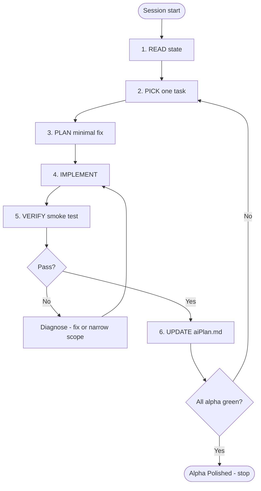

# Antidote — AI Plan Loop

**Purpose:** Repeatable workflow for any agent session until [`aiPlan.md`](aiPlan.md) alpha criteria are all green.

**Rule:** One session = one primary backlog item (P0.x–P3.x) taken to verified done, unless fixing a boot blocker that prevents all testing.

---

## Loop overview



---

## Step 1 — READ (5 min)

1. Open [`aiPlan.md`](aiPlan.md) §1 status table and §5 backlog — find highest priority **unchecked** item.
2. Skim §4 pitfalls before touching `player.js`, `interaction_modal.js`, or `index.php` script tags.
3. Run game locally if possible:
   ```
   http://localhost:11011/Dev/ANTIDOTE%20game%20project/antidote2/index.php
   ```
4. Hard refresh (`Ctrl+Shift+R`); open DevTools console — note **first red error** (fix boot errors before feature work).
5. Check git status — know what is already dirty; do not revert user changes.

**Stop READ early if:** console shows `SyntaxError`, `initPlayer not found`, or black screen → task becomes **P0.1 boot fix** regardless of backlog order.

---

## Step 2 — PICK one task

Selection rules:

| Priority | Pick when |
|----------|-----------|
| **P0** | Game does not load, player missing, inventory broken, death screen broken |
| **P1** | Boot OK but build/economy untested or broken |
| **P2** | Economy OK but cure cannot complete end-to-end |
| **P3** | Core loop works once; fog, units, polish, cleanup |

**Do not pick P4** unless user explicitly requests post-alpha scope.

Write down in your session notes:

```
TASK: P?.? — <title>
ACCEPT: <one sentence from aiPlan smoke test>
FILES: <expected files>
```

---

## Step 3 — PLAN minimal fix

Before editing code:

- [ ] Confirm task is **in alpha scope** (aiPlan §2)
- [ ] Identify **smallest diff** that satisfies ACCEPT — no drive-by refactors
- [ ] If adding a classic `<script>` tag: plan IIFE or unique global names
- [ ] If touching movement: preserve ground-fix logic (aiPlan §4 item 5)
- [ ] If touching map preview: keep `setPreviewType` idempotent

**Red flags — stop and simplify:**

- Adding React to `index.php` without user request
- New top-level `const FOO` in two classic files
- Moving cure constants without checking `curing_mechanic.js` UI bindings
- Implementing features from `projectScope.txt` not listed in aiPlan §2

---

## Step 4 — IMPLEMENT

### Coding standards (match repo)

- Config constants at top of file; `window.*` only for cross-script API
- Classic scripts: prefer IIFE + explicit `window.exports` (see `interaction_modal.js`)
- ES modules: import in `main.js`, attach to `window` for classic script consumers
- Comments only for non-obvious logic
- Do **not** commit unless user asks

### Implementation checklist

- [ ] Change scoped to TASK only
- [ ] No duplicate global identifiers across classic scripts
- [ ] Functions called from multiple places are top-level, not nested in `init*`
- [ ] HUD updates call `window.updateHUD` where inventory/stats change
- [ ] Range-limited interactions use `InteractionModal` / `getInteractionRange()` / `getGatherRange()`

---

## Step 5 — VERIFY

### 5a — Automated / static checks

```bash
# From repo root — quick duplicate global scan (classic scripts in index.php)
# Manually grep for duplicate const/let names if adding scripts
```

- [ ] No linter errors in edited files (if IDE reports them)
- [ ] Read edited sections once for typos in `window.*` names

### 5b — Console gate (required)

After hard refresh:

- [ ] **Zero** `Uncaught` errors during: load → lock pointer → 30s idle → tested feature
- [ ] Ignore: Tracking Prevention warnings, `favicon.ico` 404

### 5c — Feature smoke (required)

Run the **specific ACCEPT criterion** from Step 2 plus regression checks:

| Always re-test | Why |
|----------------|-----|
| Move + strafe 3s | Movement regressions |
| Console clean | Boot regressions |
| Task-specific ACCEPT | Definition of done |

If browser automation unavailable, state what was verified statically and what user must confirm.

### 5d — Fail handling

| Symptom | Likely cause | Action |
|---------|--------------|--------|
| `Identifier X already declared` | Duplicate classic global | IIFE or rename; remove duplicate |
| `initPlayer not found` | `player.js` parse error | Fix syntax first |
| Black screen + HUD | Preview/mesh recreated every frame | Idempotent preview |
| Wood collect throws | Function scope / missing `window` | Top-level function |
| Strafe jitter | Ground state reset | See aiPlan §4 item 5 |
| Spawner missing globals | Load order / player not init | Fix P0.1 |

**Max 3 fix attempts** per sub-issue; then document blocker in aiPlan §8 and pick next task or ask user.

---

## Step 6 — UPDATE aiPlan.md

After verified pass:

1. Mark backlog item `[x]` in §5
2. Update §1 status emoji for affected criteria (🟢 / 🟡 / 🔴)
3. Append row to §8 session log:

```markdown
| YYYY-MM-DD | P?.? short title | 🟢 PASS: <what you verified> |
```

If partial:

```markdown
| YYYY-MM-DD | P?.? short title | 🟡 PARTIAL: <done> / BLOCKED: <remaining> |
```

---

## When to stop the loop

### Stop with success

All of:

- aiPlan §1 criteria A1–A12 are 🟢
- aiPlan §5 items P0.1–P3.6 are `[x]`
- Full §6 smoke script passes once end-to-end

Report to user:

> **Alpha Polished** — core sandbox loop playable; see aiPlan §8 log.

### Stop with blocker

After 3 failed attempts on same P0 item, report:

- Error messages (exact)
- Files touched
- Hypothesis
- Recommended next step

Do not expand scope to P4.

---

## Session prompt template (copy for agent)

```
Follow aiPlanLoop.md for Antidote.

1. READ aiPlan.md status + console on index.php
2. PICK highest open P0–P3 task
3. Implement minimal fix (alpha scope only)
4. VERIFY: console clean + task ACCEPT + movement regression
5. UPDATE aiPlan.md §1, §5, §8

Do not commit unless asked. Do not add React to index.php.
```

---

## Anti-patterns (never do)

- ❌ Implement 12-region conquest because `projectScope.txt` mentions it
- ❌ Duplicate `const`/`let` across classic scripts without IIFE
- ❌ Large refactor while P0 fails
- ❌ Skip console check after JS changes
- ❌ Mark `[x]` without running ACCEPT test
- ❌ Wire `index.tsx` / React HUD without explicit user request

---

## Quick reference links

| Doc | Use |
|-----|-----|
| [aiPlan.md](aiPlan.md) | Scope, backlog, architecture, smoke script |
| [projectScope.txt](projectScope.txt) | Long-term design reference only |
| [README.md](README.md) | Minimal; not a build guide |

---

*Loop version: 2026-06-04 — keep in sync when alpha definition or entry URL changes.*
